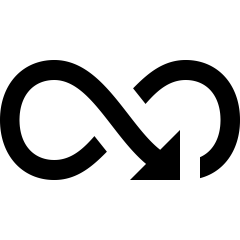
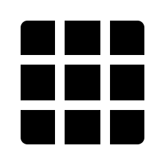
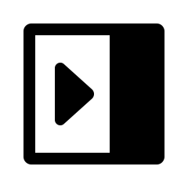
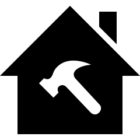
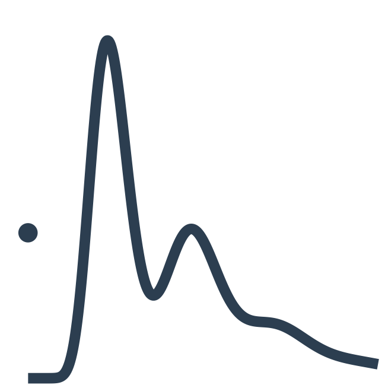
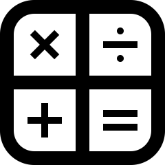
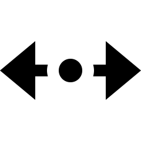
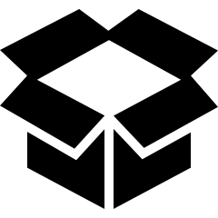
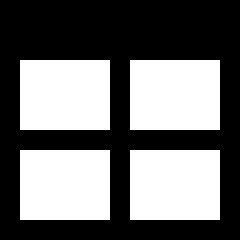

```{r}
#| label: setup
#| include: false
source("./R/makeImages.R")
```


# Introduction

## Data types: Continuous data

::: {.fragment}
- **Continuous on real line** (e.g., altitude): $Y \in \mathbb{R}$.
  - Model using the usual regression models.
:::

::: {.fragment}
- **Positive continuous** (e.g., yields): $Y\in \mathbb{R}_{+}$.
  - gamma regression (e.g., generalized linear models; GLMs).
:::

::: {.fragment}
- **Proportions** (e.g., cloud cover): $Y\in (0, 1)$.
  - beta regression.
:::

::: {.fragment}
- **Directions** (e.g., movements of animals): $Y\in (0, 2\pi)$.
  - von Mises regression.
:::


{.nostretch .bottom-icon width="10%"}


## Data types: Discrete data

::: {.fragment}
- **Discrete** (e.g., counts of insects): $Y \in \mathbb{N}$
  - Poisson regression (also a GLM).
:::

::: {.fragment}
- **Binomial counts** (e.g., seed germination): $Y\in \{0, 1, 2, \dots, m\}$.
  - logistic regression (also a GLM).
:::


{.nostretch .bottom-icon width="10%"}


## Data types: Mixed data


- **Continuous data with exact zeros** (e.g., rainfall): $Y\in \{0\}\cup R_+$.
  - What types of models could we use...?

{.nostretch .bottom-icon width="10%"}

::: {.fragment}
- Continuous data with exact zeros is surprisingly common: 

  - Rainfall 
  (e.g., @yunusModellingDailyRainfall2017, @hasanSimplePoissonGamma2010; @dunnPrecipitationOccurrenceAmount2004).
  - Fisheries: Catch per unit effort (CPUE) 
  (e.g., @candyModellingCatchEffort2004; @dunnImprovingComparisonsModels2009).
  - Root length density of apple trees 
  (e.g., @dunnSeriesEvaluationTweedie2005; @silvaAnalysisDistributionRoot1999).
  - Insurance payouts 
  (e.g., @habermanGeneralizedLinearModels1996).
  - Alcohol consumption in teenagers 
  (e.g., @gilchristFittingTweedieModels1999).
  - Survival analysis 
  (e.g., @aalenModellingHeterogeneitySurvival1992).
  - Transcriptomics
  (e.g., @mallick2022differential; @wu2023inferring).
:::


## Mixed data: models


Continuous data with exact zeros can appear for different reasons:


:::: {.columns}
::: {.column width="50%" .fragment}

{fig-align="center" width="10%"}

- **Censoring**: A genuine, natural zero.
- *Example*: Pollutant or chemical concentrations below the instrument’s detection limit.

:::

::: {.column width="50%" .fragment}
{fig-align="center"  width="10%"}

- **Structure**: The structure of the data naturally leads to mixed data.
- *Example*: Daily rainfall: \ day with no rain, amount exactly 0; otherwise a positive continuous amount.
:::
:::

::: {.fragment}
Different reasons may lead to different modelling considerations.
:::


## PG models: development

::: {.fragment}
- **Number of precipitation events in any month** $N$.
  - $N$ has a *Poisson* distribution: $N\sim\text{Pois}(\lambda)$ ($N$ could be zero).
:::

::: {.fragment}
- **Precipitation amounts** when rain does fall $R$.
  - Rainfall event $i$ receives rainfall $R_i$; *gamma* distribution: $\text{Gam}(-\alpha, \gamma)$.

:::

::: {.fragment}

- **_Total_ monthly precipitation**, $Y$.
  - Poisson sum of gamma random variables:
$$
  Y 
  = 
  \begin{cases}
    0                           & \text{if $N = 0$};\\
    R_1 + R_2 + \cdots + R_N    & \text{if $N > 0$}.
  \end{cases}
$$
:::


{.nostretch .bottom-icon width="10%"}


## PG models: development

::: {.incremental}
- The **Poisson sum of gamma variables** distribution: deduced by working with cumulant generating functions.
- The probability density function is complicated: **no closed form**...
- ... apart from well-known special cases:

  ::: {.nonincremental}
  - Normal distributions.
  - Gamma distributions.
  - Poisson distributions.
  :::

- **Poisson--gamma models** belong to the **exponential dispersion model** (EDM) family...
- ...so fit the GLM framework: **having no closed form does not matter for fitting GLMs**.
:::


{.nostretch .bottom-icon width="10%"}


## PG models

To **fit** GLMs, only the **mean** and the **variance** needed.

::: {.fragment fragment-index=1}
::: {.nonincremental}
- _All_ EDMs have **mean** $\text{E}[Y] = \mu$.
- _All_ EDMs have **variance** $\text{var}[Y] = \phi V(\mu)$, where:

  - $\phi > 0$ is some constant (the **dispersion parameter**);
  - $V(\mu)$ is the **variance function**.
:::
:::


## Tweedie models

::: {.left-table}

| Distribution         | Var fn $V(\mu)$ |
|----------------------|-----------------|
| Normal distribution  | $V(\mu) = 1$ |
| Poisson distribution, if $\phi=1$ | $V(\mu) = \mu$ |
| Gamma distribution   | $V(\mu) = \mu^2$ |
| Inverse Gaussian     | $V(\mu) = \mu^3$ |
| 'Equivalent' to $y^* = 1/y$ transform in regression | $V(\mu) = \mu^4$ |

: {tbl-colwidths="[59,23]"}
:::


## Tweedie models

::: {.left-table}
| Distribution             | Var fn $V(\mu)$    | $\xi$              |
|--------------------------|--------------------|--------------------|
| Normal distribution      | $V(\mu) = 1$       | $0$          |
| Poisson distribution, if $\phi=1$ | $V(\mu) = \mu$ | $1$  |
| Gamma distribution       | $V(\mu) = \mu^2$   | $2$          |
| Inverse Gaussian         | $V(\mu) = \mu^3$   | $3$          |
| 'Equivalent' to $y^* = 1/y$ transform in regression | $V(\mu) = \mu^4$ | $4$ |
| Tweedie (power-variance) | $V(\mu) = \mu^\xi$ | $\notin (0,1)$ |
| [Poisson--gamma]{.fragment fragment-index=2} | [$V(\mu) = \mu^\xi$]{.fragment fragment-index=2} | [$\in (1, 2)$]{.fragment fragment-index=2} |
: {tbl-colwidths="[59,23,10]"}
:::


## Power-variance models

| Range of $\xi$ | Distribution Type                                                         |
|----------------|---------------------------------------------------------------------------|
| $\xi \le 0$    | Continuous on $(-\infty, \infty)$; e.g., Normal ($\xi = 0$)               |
| $0 < \xi < 1$  | **No densities exist**                                                    |
| $\xi = 1$      | Non-negative discrete; e.g., Poisson ($\xi = 1$ and $\phi = 1$)           |
| $1 < \xi < 2$  | Mixed on $y \ge 0$ (mass at $y = 0$); Poisson--gamma distributions        |
| $\xi \ge 2$    | Continuous on $(0, \infty)$ <br> e.g.: Gamma ($\xi=2$); inv. Gauss ($\xi = 3$)                             |

: {tbl-colwidths="[25,75]"}


## Power-variance densities: examples

::: {.content-visible when-format="revealjs"}
{fig-align="center"}
:::


::: {.content-visible when-format="beamer"}
Tweedie PDF examples
:::


## Tweedie distributions

::: {.fragment fragment-index=1}
::: {.nonincremental}
The Tweedie family is a three-parameter family of distributions:

- $\mu$ (the **mean**);
- $\phi > 0$ (the **dispersion parameter**);
- $\xi$ (the **index parameter**: *which* Tweedie distribution, sometimes denoted as $p$).
:::
:::

::: {.fragment fragment-index=2}
::: {.nonincremental}
- The estimation of $\mu$ follows standard GLM algorithms... if $\xi$ is known.
- Tweedie GLMs can be fitted in Genstat, R, SPSS, etc.
:::
:::

{.nostretch .bottom-icon width="10%"}


## Tweedie distributions: evaluation

- Densities evaluation **not** necessary for model **fitting**, but **is** necessary for

  ::: {.nonincremental .fragment}
  - **estimating** a value for $\xi$ (and hence fitting a model...).
  - **model evaluation**: computing quantiles and residuals.
  - **estimating $\phi$**: maximum likelihood estimation.
  - and so on...
  :::

{.nostretch .bottom-icon width="10%"}


## Tweedie distributions: evaluation

*Tweedie densities functions* must be, in general, evaluated numerically:

::: {.fragment fragment-index=2}

- Saddlepoint *approximation*: can be inaccurate. 
- Infinite series [@dunnSeriesEvaluationTweedie2005].
- Infinite oscillating integrals [@dunnEvaluationTweedieExponential2008].
:::

*Tweedie cumulative distribution functions* must be, in general, evaluated numerically:

::: {.fragment fragment-index=3}
- Saddlepoint *approximation*: can be inaccurate. 
- Infinite series [@dunnEvaluationTweedieExponentialCDF2026] for $1 <\xi < 2$.
- Infinite oscillating integrals [@dunnEvaluationTweedieExponentialCDF2026].
:::

{.nostretch .bottom-icon width="10%"}


# Evaluation: infinite series

## Evaluation: infinite series

- Tweedie densities can be written in terms of infinite series.
- For $1 < \xi < 2$: in terms of Wright's generalized Bessel function $W(y, \phi, \xi)$:
$$
  \sum_{j = 1}^\infty 
  \frac{y^{-j(2 - \xi)/(1 - \xi)} (\xi - 1)^{(2 - \xi)/(1 - \xi) j}}
       {\phi^{j(1-(2 - \xi)/(1 - \xi))}(2 - \xi)^j\, j!\,\Gamma\big(-j(2 - \xi)/(1 - \xi)\big)}
$$

- A similar expression exists for $\xi > 2$.
- Messy; evaluating, in principle, easy: add lots of terms.
- Sometimes the terms are a *long way* from $j = 1$.
- Sometimes a very large number of terms are needed.
- So **which** terms, and **how many** terms, must be summed?


## Evaluation: series strategy

We directly sum the infinite series, only over the necessary terms:

::: {.fragment fragment-index=2}
::: {.nonincremental}
- Using Stirling's approximation for the gamma function, plus other approximations...
- ... then treat the index of summation and continuous...
- ... and differentiation to find where the terms reach a maximum.
:::
:::

::: {.fragment fragment-index=3}
::: {.nonincremental}
Then: sum terms either side of the maximum until the contributions are negligible.
:::
:::


{.nostretch .bottom-icon width="20%"}


## Evaluation: series

{fig-align="center"}


## Evaluation: series

::: {.fragment fragment-index=2}
::: {.nonincremental}
- Sometimes, the **number of terms** required is in the thousands.
- Sometimes, the **terms themselves** don't start making contributions until $j = 100\,000$
:::
:::

::: {.fragment fragment-index=3}
::: {.nonincremental}
- Sometimes, the numerical evaluation can be tricky (e.g., factorials involving index $j$).
:::
:::

{.nostretch .bottom-icon width="10%"}


## Evaluation: series

{fig-align="center"}


# Evaluation: integrals

## Evaluation: integrals

- Fourier inversion of the **Moment Generating Function** $M_Y(t)$:
$$
\begin{align*}
  f_Y(y) 
  &= 
  \frac{1}{2\pi} \int_{-\infty}^{\infty} \exp[ K_Y(it) - ity]\, dt\\
  &=
  \frac{1}{2\pi} \int_{-\infty}^{\infty} \exp k(t)\, dt
\end{align*}
$$
where $i = \sqrt{-1}$, and $K_Y(t) = \log M_Y(t)$ where...


## Evaluation: infinite integrals

\begin{eqnarray}
  K_Y(t) 
  &=& \log M_Y(t) \nonumber \\
  &=& 
  \begin{cases}
    \displaystyle
    \frac{\mu^{2 - \xi}}{\phi(2 - \xi)} \left\{ \left[ 1 + \phi t(1 - \xi)\mu^{\xi - 1} \right]^{(2-\xi)/(1-\xi)}- 1\right\} 
                                                & \text{for $\xi\ne1, 2$} \\[15pt]
    \displaystyle
    \frac{\mu}{\phi}[\exp(\phi t) - 1]                                                                      & \text{for $\xi = 1$} \\[15pt]
    \displaystyle
    -\frac{1}{\phi}\log(1 - \mu t\phi)          & \text{for $\xi = 2$}.
  \end{cases}
      \label{EQ:intro:Tweediecgf}
\end{eqnarray}

- $\xi = 1$ (Poisson) and $\xi = 2$ (Gamma) have a closed form.
- So the focus is $\xi\ne 1, 2$.


## Evaluation: infinite integrals

- Extracting the **real components**:
$$
  f_Y(y) 
  = 
  \frac{1}{2\pi} \int_{-\infty}^{\infty} \exp[ \Re k(t) ]\, \cos \Im k(it) \, dt,
$$

- Integrand: 
  - **exponentially decaying** (i.e., $\exp[ \Re k(t) ]$); and
  - **oscillating** (i.e., $\cos \Im k(it)$) function.


## Evaluation: infinite integrals

{fig-align="center"}


## Evaluation: infinite integrals

::: {.content-visible when-format="revealjs"}
{fig-align="center"}
:::

::: {.content-visible when-format="beamer"}
Areas in integration
:::


## Evaluation: infinite integrals

$$
  f_Y(y) 
  = 
  \frac{1}{\pi} \int_{0}^{\infty} \exp[ \Re k(t) ]\, \cos \Im k(it) \, dt,
$$

- The integrand zeros occur when
$$
  \cos \Im k(t) = 0 \implies k(t) = \frac{\pi}{2} + m\pi\quad\text{for integer $m$.}
$$
- To find the zeros, the behaviour of $k(t)$ needs to be studied.


## Evaluation: infinite integrals

{fig-align="center"}

## Evaluation: infinite integrals

{fig-align="center"}


## Evaluation: infinite integrals

::: {.nonincremental}
**In principle**, the algorithm is simple:

- Find the zeros of the integrand...
- Find the area of each integrand (numerical quadrature)...
- Sum the areas.
:::

::: {.fragment fragment-index=1}
::: {.nonincremental}
**Substantial challenges** when aiming for high accuracy: 
 
1. Accumulated rounding error when summing almost-equal, positive and negative areas.
2. Integrands are not always this nicely behaved...
:::
:::


::: {.r-stack}
{.fragment .fade-out fragment-index=1 .bottom-icon width="10%"}

{.fragment fragment-index=1 .bottom-icon width="10%"}
:::


## Evaluation: infinite integrals

::: {.nonincremental}
**Rounding error**

- Accumulated rounding error when summing almost-equal, positive and negative areas.
- **Numerical acceleration** techniques speed the convergence. 
- Many acceleration techniques available, depending on the type of decay behaviour.
- We use Sidi's $W$‑transform (@BIB:Sidi:extrapolation, @BIB:Sidi:veryoscillatory).
:::

{.nostretch .bottom-icon width="10%"}


## Evaluation: acceleration techniques

::: {.content-visible when-format="revealjs"}
{fig-align="center"}
:::

::: {.content-visible when-format="beamer"}
Areas as series
:::


## Evaluation: infinite integrals

- **Integrand behaviour**

  - Integrands are not always this nicely behaved...
  - Lots of mathematical understanding of the integrand helps.
  - Using some identities to simplify the integrand... sometimes helps.


{.nostretch .bottom-icon width="10%"}


## Evaluation: finding the zeros

{fig-align="center"}


## Evaluation: finding the zeros

{fig-align="center"}


# Example


## Example: Quiplie rainfall

Consider Quilpie rainfall.

::: {.incremental}
- **Randomness**: data mixed: use a Poisson--gamma probability model.
- **Structure**: log-link function.


  ::: {.nonincremental}
  - Ensures predicted means are always positive values.
  - Suits the data.
  - The effect of the covariates $x_j$ on $\mu$ is *multiplicative* not *additive*.
  - As a covariate: use the SOI.
  :::
:::

- The model is
$$
\begin{cases} 
  Y_i \sim \text{Tweedie}(\mu_i; \xi) & \text{(random)}\\ 
  \log \mu_i = \mathbf{X}\vec{\beta} & \text{(systematic)} 
\end{cases}
$$


## Example: process

::: {.incremental}
Fitting **process** like fitting other GLMs, with some idiosyncrasies.

1. Determine *which* Tweedie distribution is appropriate (i.e., the value of $\xi$). 
2. Fit the GLM, usually using a *log* link.

   ::: {.nonincremental}
   - Usual Wald tests ($t$-tests) and likelihood ratio tests ($F$-tests) can be used.
   - AIC needs full likelihood calculations.
   :::
  
3. Examine diagnostics (using quantile residuals if possible) to evaluate model.
:::


{.nostretch .bottom-icon width="10%"}


## Example: the data


::: {.nonincremental}
- Total July rainfall at Quilpie:
:::

```
  Year Rain   SOI   Phase
1 1921 38.4   2.7     2 
2 1922  0.0   2.0     5 
3 1923  0.0 -10.7     3 
4 1924 24.4   6.9     2 
5 1925  0.0 -12.5     3 
6 1926  9.1  -1.0     4 
```

{.nostretch .bottom-icon width="10%"}


## Example: find the value of $\xi$

{fig-align="center"}


## Example: the model

$$
\begin{cases} 
  Y_i \sim \text{Tweedie}(\mu_i; \xi = 1.4)   & \text{(random)}\\ 
  \log \mu_i = 2.61 + 0.073\text{SOI}         & \text{(systematic)} 
\end{cases}
$$


{fig-align="center"}


## Example: model evaluation


| Variable  | Coefficients | Standard error  | $t$-score | $P$-value   |
|-----------|--------------|-----------------|-----------|-------------|
| Intercept | 2.61         | 0.152           | 17.1      | < 0.001     |
| SOI       | 0.073        | 0.0165          | 4.42      | < 0.001     |


| Model            | Deviance | DF | Resid deviance | $F$-score | $P$-value   |
|------------------|----------|----|----------------|-----------|-------------|
| Intercept only   |          | 67 | 617.44         |           |             |
| + SOI            | 120.63   | 66 | 496.81         | 17.09     | < 0.001     |


## Example: diagnostic analysis

{fig-align="center"}


# Concluding

## Accuracy

- No closed form exists (in general) for the density functions.
- No 'hold standard' exists for **checking the accuracy** of the algorithms.
- But, the algorithms:
  - gives accurate results for the closed-form cases ($\xi = 2$ and $\xi = 3$);
  - convergence occurs to machine accuracy where possible;
  - give sensible answers;
  - produce similar answers for **both** the series and inversion methods for the same parameters.
  
{.nostretch .bottom-icon width="10%"}


## Packaging

::: {.nonincremental}
Algorithms prepared and packaged for use in the `tweedie` package [@dunnTweedieTweedieExponential2022].

- Freely available on CRAN.
- Coded in R and FORTRAN.
- Over 1 million downloads.
:::

{.nostretch .bottom-icon width="10%"}


## The hybrid approach


- We can switch between the **series** and **inversion** methods, and use the most accurate method for any given $(y, \xi, \mu, \phi)$ combinations.
- We also have a faster method, using accurate interpolation of the stored values.
- Much faster, but loses some accuracy in some limiting cases.

{.nostretch .bottom-icon width="10%"}


## The future

Parts of the parameters space (i.e., $(y, \xi, \mu, \phi)$ combinations) are still challenging for accurate evaluation.

- $\xi\to1$ (Poisson) presents challenges.
- $\xi\to2$ (Gamma) presents challenges.
- Other evaluation method are possible, which may work well and/or faster in parts of parameter space.
- We have plans for exploring these...

{.nostretch .bottom-icon width="10%"}


  
## The future

- The cumulative distribution function (CDF) similarly has no closed forms.
- About to submit a paper on computational techniques for the CDF.
- Similar techniques (series; inversion) but numerous differences and mathematical problems.

{.nostretch .bottom-icon width="10%"}


## References  {.scrollable .smaller .allowframebreaks style="font-size: 0.6em;"}

::: {#refs}
:::


